# Experiment Report — final_n3_baseline

- **Generated:** 2026-10-15T02:09:21Z
- **Algorithms compared:** pbft, pos, pow
- **Repetitions per algorithm:** up to 10
- **Significance threshold (α):** 0.05

## Reliability

Runs where `committed_by_quorum == 0` — i.e. the consensus protocol
made no forward progress and no transaction reached the quorum. These
are **excluded** from the per-metric tables below; they belong to the
reliability metric itself, not to the TPS / latency / energy aggregates.

| Algorithm | Total runs | Failed | Successful | Failure rate |
|---|---|---|---|---|
| pbft | 10 | 0 | 10 | 0.0% |
| pos | 10 | 1 | 9 | 10.0% |
| pow | 10 | 2 | 8 | 20.0% |

_Algorithms with non-zero failure rates have their dropouts removed
from the metric aggregates below; the totals reflect only runs where
consensus actually progressed._

Nonzero progress can be partial; it does not imply all submitted transactions finished.

| Algorithm | Partial | Complete | Committed total | Energy all runs (J) | Pooled J/committed tx |
|---|---:|---:|---:|---:|---:|
| pbft | 0 | 10 | 1000 | 49.2207 | 0.0492207 |
| pos | 0 | 9 | 900 | 20.7589 | 0.0230655 |
| pow | 7 | 1 | 342 | 464.845 | 1.3592 |

Pooled J/tx includes energy from zero-progress runs. Metric tables below condition on >0 progress, including partial runs. Latency samples exclude unconfirmed requests; interpret them with completion counts.

## Summary

| Metric | Test | Statistic | p-value | α=0.05 verdict |
|---|---|---|---|---|
| Throughput (TPS) | ANOVA | 357.741 | 1.36585e-18 | ✓ different |
| Latency p50 (ms) | Kruskal-Wallis | 23.071 | 9.77469e-06 | ✓ different |
| Latency p95 (ms) | Kruskal-Wallis | 23.071 | 9.77469e-06 | ✓ different |
| Finality p95 (ms) | Kruskal-Wallis | 23.071 | 9.77469e-06 | ✓ different |
| Energy (J) | Kruskal-Wallis | 23.071 | 9.77469e-06 | ✓ different |
| Bytes per Tx | ANOVA | 12.927 | 0.000154924 | ✓ different |

## Throughput (TPS)

### Descriptives
| Algorithm | n | mean | stdev | median | min | max |
|---|---|---|---|---|---|---|
| pbft | 10 | 44.967 | 0.193 | 44.995 | 44.549 | 45.203 |
| pos | 9 | 30.514 | 3.375 | 29.628 | 27.057 | 37.760 |
| pow | 8 | 8.035 | 4.012 | 8.001 | 3.241 | 14.262 |

### Normality (Shapiro-Wilk)
| Algorithm | Shapiro W | p-value | normal at α |
|---|---|---|---|
| pbft | 0.926 | 0.413939 | yes |
| pos | 0.885 | 0.17884 | yes |
| pow | 0.917 | 0.408834 | yes |

**Test:** ANOVA → statistic = 357.741, p = 1.36585e-18  →  algorithms **differ** at α = 0.05

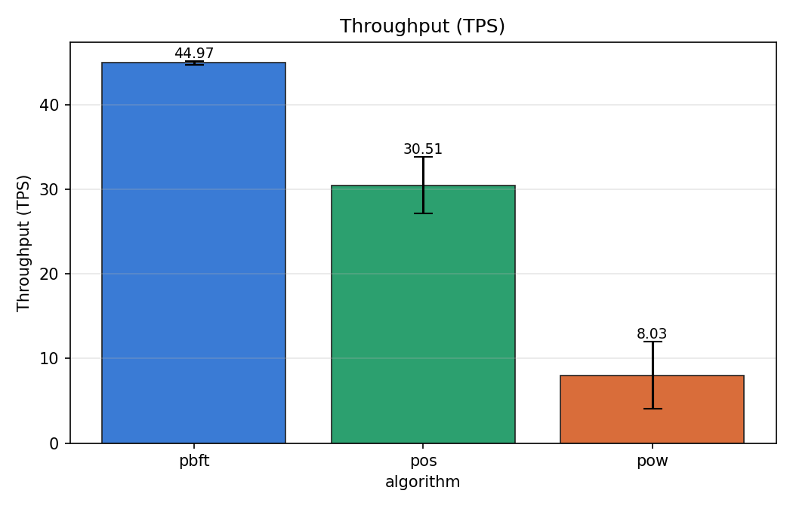
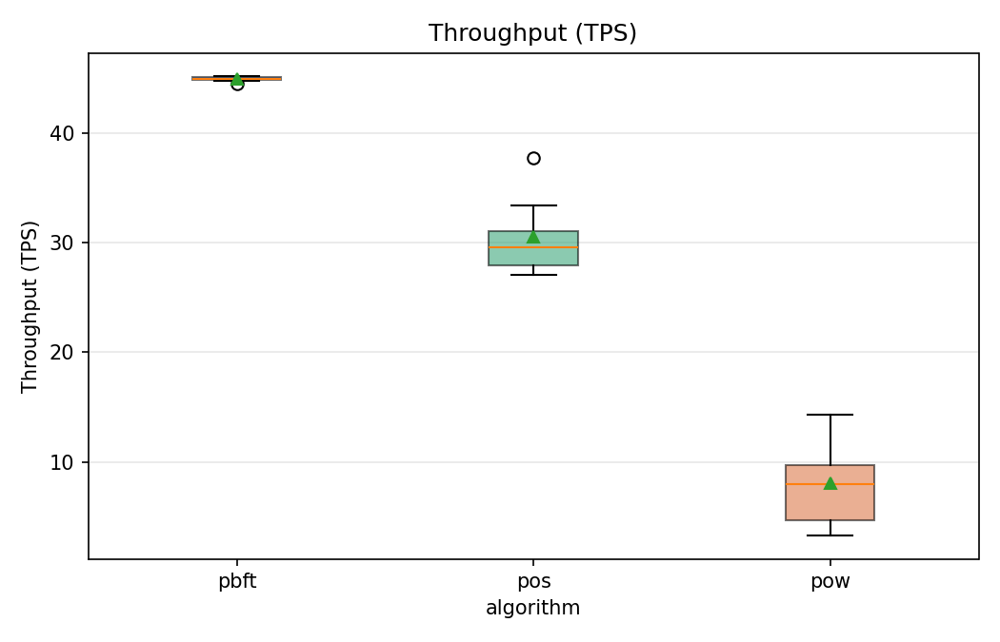

## Latency p50 (ms)

### Descriptives
| Algorithm | n | mean | stdev | median | min | max |
|---|---|---|---|---|---|---|
| pbft | 10 | 2.460 | 0.594 | 2.543 | 1.567 | 3.303 |
| pos | 9 | 977.189 | 235.783 | 1052.226 | 518.534 | 1240.370 |
| pow | 8 | 4185.748 | 1158.656 | 4575.685 | 1517.898 | 5201.505 |

### Normality (Shapiro-Wilk)
| Algorithm | Shapiro W | p-value | normal at α |
|---|---|---|---|
| pbft | 0.945 | 0.608372 | yes |
| pos | 0.882 | 0.165526 | yes |
| pow | 0.751 | 0.00828023 | no |

**Test:** Kruskal-Wallis → statistic = 23.071, p = 9.77469e-06  →  algorithms **differ** at α = 0.05

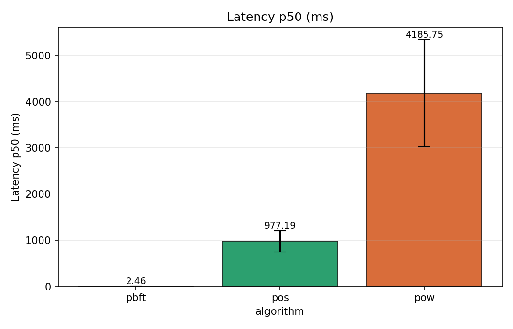
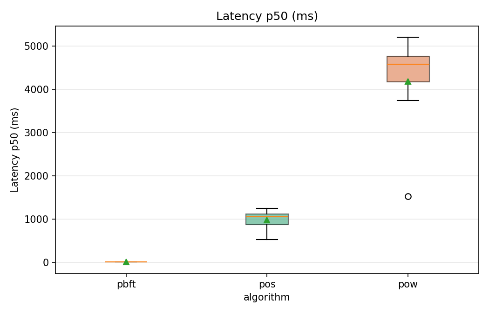

## Latency p95 (ms)

### Descriptives
| Algorithm | n | mean | stdev | median | min | max |
|---|---|---|---|---|---|---|
| pbft | 10 | 16.046 | 7.578 | 14.616 | 6.701 | 35.394 |
| pos | 9 | 1284.812 | 218.828 | 1334.796 | 847.323 | 1514.815 |
| pow | 8 | 4682.887 | 1365.773 | 5090.927 | 1722.286 | 6133.378 |

### Normality (Shapiro-Wilk)
| Algorithm | Shapiro W | p-value | normal at α |
|---|---|---|---|
| pbft | 0.791 | 0.0113814 | no |
| pos | 0.902 | 0.262 | yes |
| pow | 0.846 | 0.0874509 | yes |

**Test:** Kruskal-Wallis → statistic = 23.071, p = 9.77469e-06  →  algorithms **differ** at α = 0.05

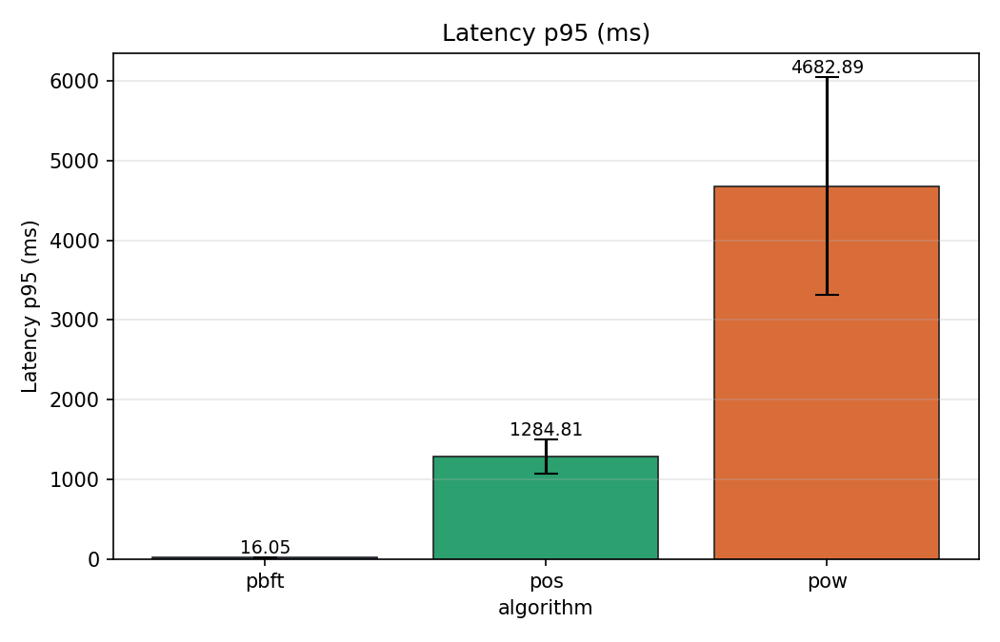
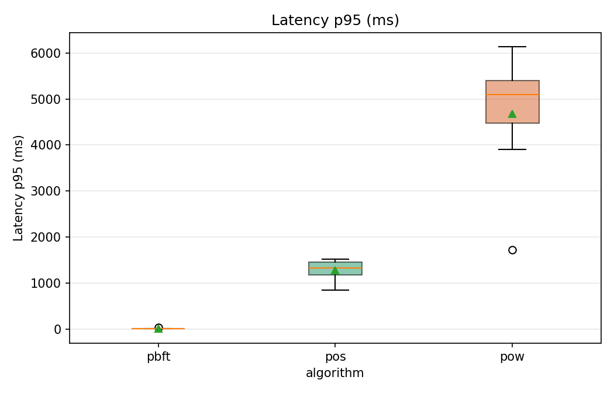

## Finality p95 (ms)

### Descriptives
| Algorithm | n | mean | stdev | median | min | max |
|---|---|---|---|---|---|---|
| pbft | 10 | 16.046 | 7.578 | 14.616 | 6.701 | 35.394 |
| pos | 9 | 1284.812 | 218.828 | 1334.796 | 847.323 | 1514.815 |
| pow | 8 | 4682.887 | 1365.773 | 5090.927 | 1722.286 | 6133.378 |

### Normality (Shapiro-Wilk)
| Algorithm | Shapiro W | p-value | normal at α |
|---|---|---|---|
| pbft | 0.791 | 0.0113814 | no |
| pos | 0.902 | 0.262 | yes |
| pow | 0.846 | 0.0874509 | yes |

**Test:** Kruskal-Wallis → statistic = 23.071, p = 9.77469e-06  →  algorithms **differ** at α = 0.05

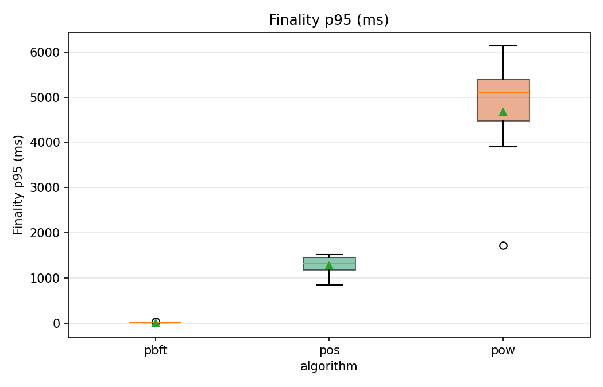

## Energy (J)

### Descriptives
| Algorithm | n | mean | stdev | median | min | max |
|---|---|---|---|---|---|---|
| pbft | 10 | 4.922 | 0.116 | 4.922 | 4.755 | 5.150 |
| pos | 9 | 2.103 | 0.170 | 2.067 | 1.881 | 2.443 |
| pow | 8 | 46.252 | 1.216 | 46.316 | 44.909 | 47.598 |

### Normality (Shapiro-Wilk)
| Algorithm | Shapiro W | p-value | normal at α |
|---|---|---|---|
| pbft | 0.904 | 0.240678 | yes |
| pos | 0.949 | 0.680325 | yes |
| pow | 0.800 | 0.0288208 | no |

**Test:** Kruskal-Wallis → statistic = 23.071, p = 9.77469e-06  →  algorithms **differ** at α = 0.05

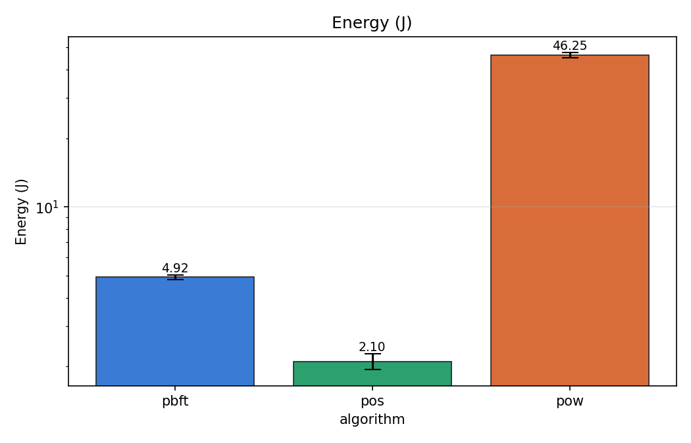
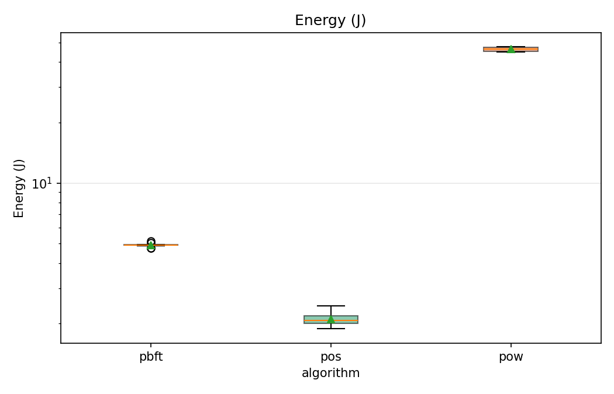

## Bytes per Tx

### Descriptives
| Algorithm | n | mean | stdev | median | min | max |
|---|---|---|---|---|---|---|
| pbft | 10 | 21533.808 | 115.823 | 21538.195 | 21372.570 | 21777.560 |
| pos | 9 | 8710.342 | 90.613 | 8688.020 | 8616.510 | 8860.260 |
| pow | 8 | 31159.333 | 16949.433 | 30698.592 | 9701.340 | 49526.050 |

### Normality (Shapiro-Wilk)
| Algorithm | Shapiro W | p-value | normal at α |
|---|---|---|---|
| pbft | 0.948 | 0.645462 | yes |
| pos | 0.894 | 0.21711 | yes |
| pow | 0.845 | 0.0856275 | yes |

**Test:** ANOVA → statistic = 12.927, p = 0.000154924  →  algorithms **differ** at α = 0.05

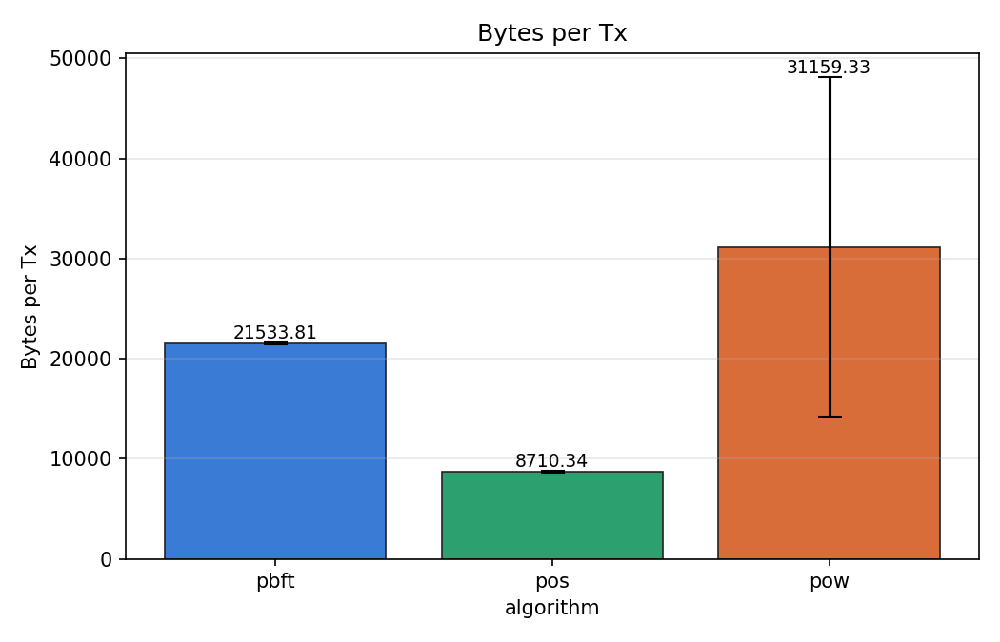
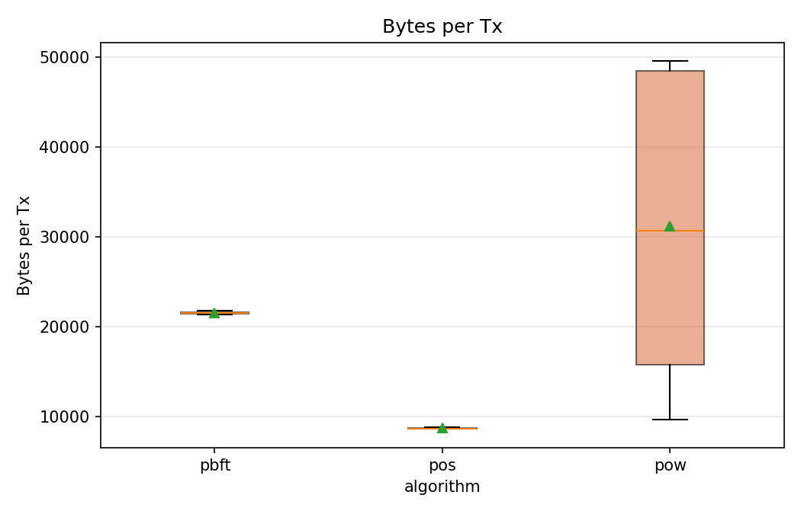

## Threats to Validity

- **Energy proxy.** The reported joules use the model
  `E = (cpu_percent_total / 100) / num_cpus * tdp_watts * duration_s`. Real CPU
  power is non-linear in utilisation (DVFS, idle draw, turbo), so absolute
  numbers are indicative; the *relative* ranking between algorithms is
  what carries weight. See `monitoring/energy_estimator.py` for caveats.
- **PoW reference implementation.** SHA-256 nonce-search at configurable
  difficulty and longest-chain fork handling with a local confirmed-prefix lock.
  This simplified lock differs from probabilistic Nakamoto finality; partitions
  and conflicting confirmed prefixes are not resolved by this prototype. Captures the
  always-on CPU cost of PoW, which is the dimension we measure.
- **PBFT simplifications.** No view changes, no checkpoints, no batching.
  Captures the three-phase agreement cost faithfully but does not stress
  recovery paths.
- **PoS simplifications.** No slashing, no nothing-at-stake protection,
  no finality gadget. Captures the single-proposer-per-slot cost.
- **Network emulation.** Pumba on local Docker Desktop applies netem via
  per-target sidecars; effective rules engage ~3 s after the call. The VPS
  Linux tc driver is an unimplemented stub. Paper-mode runs additionally compose
  delay/rate in the Pumba nettools container namespace and save effective qdiscs.
- **Sample size.** Each scenario must have ≥5 repetitions for ANOVA /
  Kruskal-Wallis to be meaningful; entries marked `skipped` indicate
  insufficient data. Statistical significance alone does not establish
  practical importance, pairwise differences, or generality to production chains.

_Edit this section for the IEEE submission with experiment-specific notes._

