# Experiment Report — final_n4_baseline

- **Generated:** 2026-10-15T02:09:22Z
- **Algorithms compared:** pbft, pos, pow
- **Repetitions per algorithm:** up to 10
- **Significance threshold (α):** 0.05

## Reliability

Runs where `committed_by_quorum == 0` — i.e. the consensus protocol
made no forward progress and no transaction reached the quorum. These
are **excluded** from the per-metric tables below; they belong to the
reliability metric itself, not to the TPS / latency / energy aggregates.

| Algorithm | Total runs | Failed | Successful | Failure rate |
|---|---|---|---|---|
| pbft | 10 | 0 | 10 | 0.0% |
| pos | 10 | 1 | 9 | 10.0% |
| pow | 10 | 8 | 2 | 80.0% |

_Algorithms with non-zero failure rates have their dropouts removed
from the metric aggregates below; the totals reflect only runs where
consensus actually progressed._

Nonzero progress can be partial; it does not imply all submitted transactions finished.

| Algorithm | Partial | Complete | Committed total | Energy all runs (J) | Pooled J/committed tx |
|---|---:|---:|---:|---:|---:|
| pbft | 10 | 0 | 928 | 91.2861 | 0.0983686 |
| pos | 0 | 9 | 900 | 36.5832 | 0.040648 |
| pow | 2 | 0 | 23 | 643.536 | 27.9798 |

Pooled J/tx includes energy from zero-progress runs. Metric tables below condition on >0 progress, including partial runs. Latency samples exclude unconfirmed requests; interpret them with completion counts.

## Summary

| Metric | Test | Statistic | p-value | α=0.05 verdict |
|---|---|---|---|---|
| Throughput (TPS) | Kruskal-Wallis | 10.797 | 0.00452376 | ✓ different |
| Latency p50 (ms) | Kruskal-Wallis | 16.286 | 0.000290805 | ✓ different |
| Latency p95 (ms) | Kruskal-Wallis | 13.522 | 0.00115803 | ✓ different |
| Finality p95 (ms) | Kruskal-Wallis | 13.522 | 0.00115803 | ✓ different |
| Energy (J) | Kruskal-Wallis | 16.286 | 0.000290805 | ✓ different |
| Bytes per Tx | Kruskal-Wallis | 16.286 | 0.000290805 | ✓ different |

## Throughput (TPS)

### Descriptives
| Algorithm | n | mean | stdev | median | min | max |
|---|---|---|---|---|---|---|
| pbft | 10 | 36.149 | 2.068 | 36.677 | 30.468 | 38.015 |
| pos | 9 | 30.899 | 3.736 | 29.284 | 27.824 | 39.742 |
| pow | 2 | 1.699 | 1.782 | 1.699 | 0.439 | 2.959 |

### Normality (Shapiro-Wilk)
| Algorithm | Shapiro W | p-value | normal at α |
|---|---|---|---|
| pbft | 0.616 | 8.59682e-05 | no |
| pos | 0.786 | 0.0139944 | no |
| pow | — | — | (n<3) |

**Test:** Kruskal-Wallis → statistic = 10.797, p = 0.00452376  →  algorithms **differ** at α = 0.05

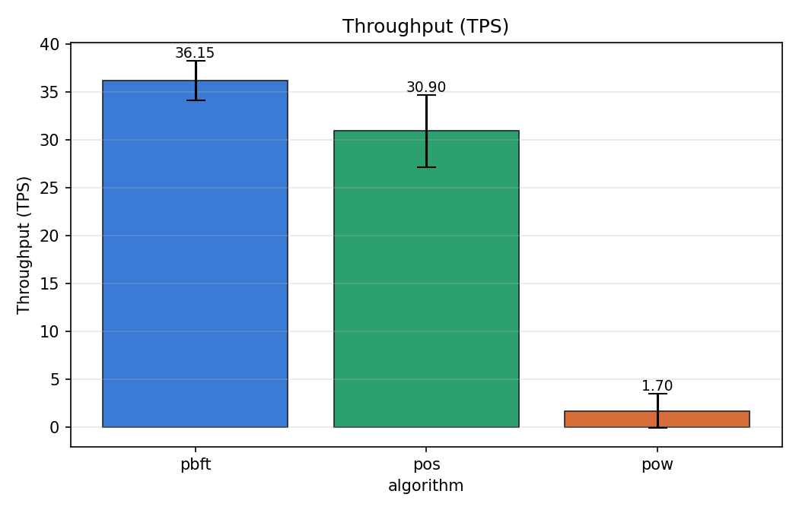
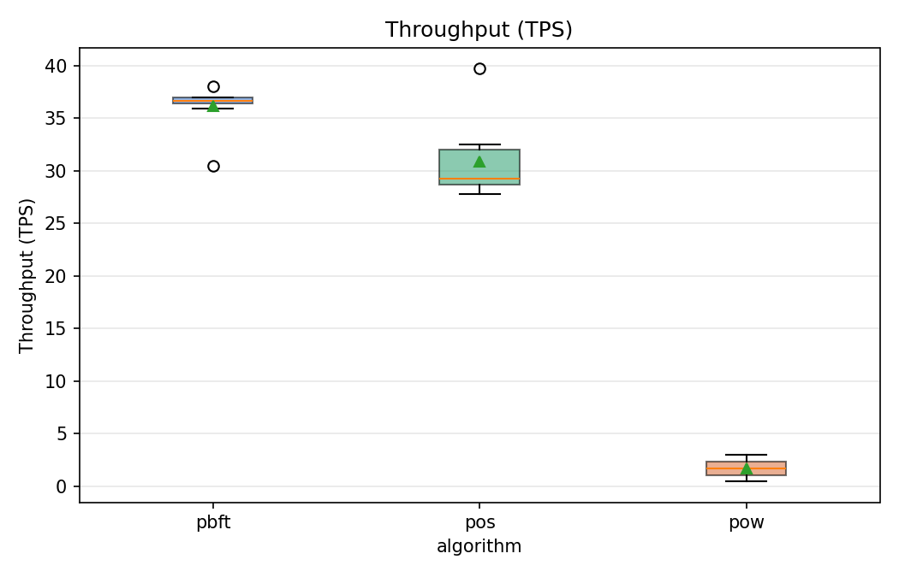

## Latency p50 (ms)

### Descriptives
| Algorithm | n | mean | stdev | median | min | max |
|---|---|---|---|---|---|---|
| pbft | 10 | 464.147 | 1.980 | 463.922 | 461.711 | 468.893 |
| pos | 9 | 899.602 | 164.805 | 866.287 | 676.796 | 1124.485 |
| pow | 2 | 4337.617 | 870.032 | 4337.617 | 3722.411 | 4952.822 |

### Normality (Shapiro-Wilk)
| Algorithm | Shapiro W | p-value | normal at α |
|---|---|---|---|
| pbft | 0.848 | 0.0552828 | yes |
| pos | 0.914 | 0.341405 | yes |
| pow | — | — | (n<3) |

**Test:** Kruskal-Wallis → statistic = 16.286, p = 0.000290805  →  algorithms **differ** at α = 0.05

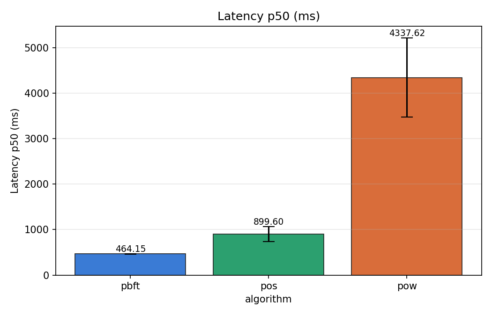
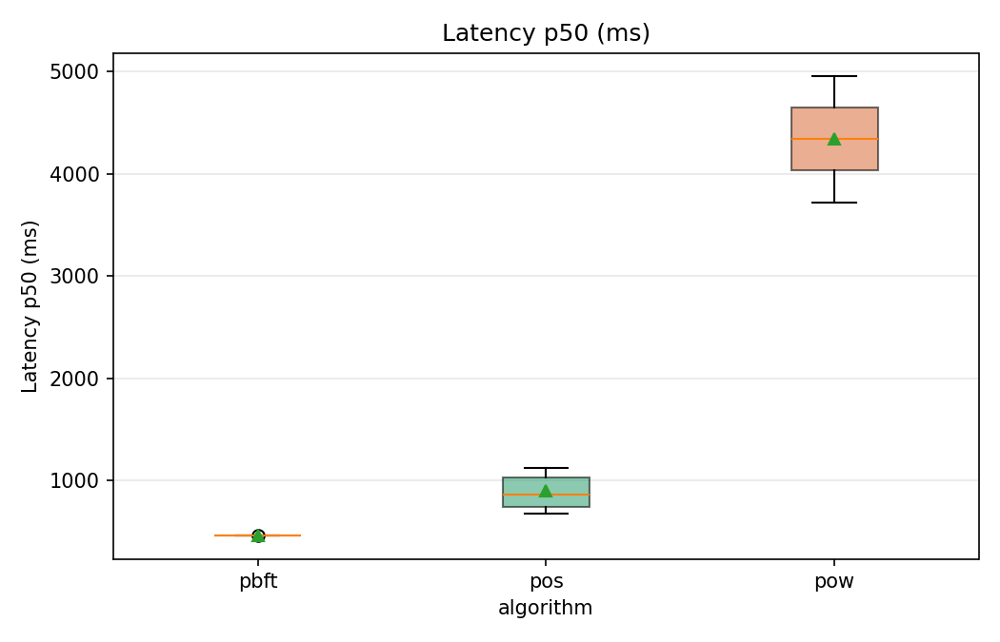

## Latency p95 (ms)

### Descriptives
| Algorithm | n | mean | stdev | median | min | max |
|---|---|---|---|---|---|---|
| pbft | 10 | 654.543 | 250.274 | 624.551 | 472.425 | 1325.826 |
| pos | 9 | 1250.399 | 169.033 | 1276.355 | 908.150 | 1416.943 |
| pow | 2 | 5300.307 | 95.774 | 5300.307 | 5232.585 | 5368.030 |

### Normality (Shapiro-Wilk)
| Algorithm | Shapiro W | p-value | normal at α |
|---|---|---|---|
| pbft | 0.665 | 0.000334169 | no |
| pos | 0.886 | 0.182232 | yes |
| pow | — | — | (n<3) |

**Test:** Kruskal-Wallis → statistic = 13.522, p = 0.00115803  →  algorithms **differ** at α = 0.05

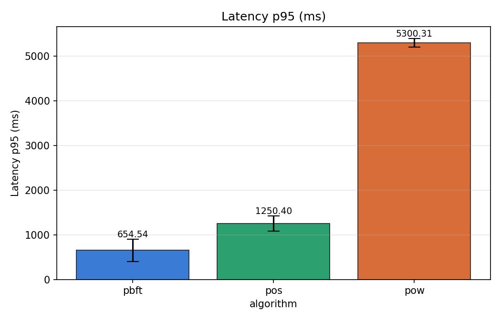
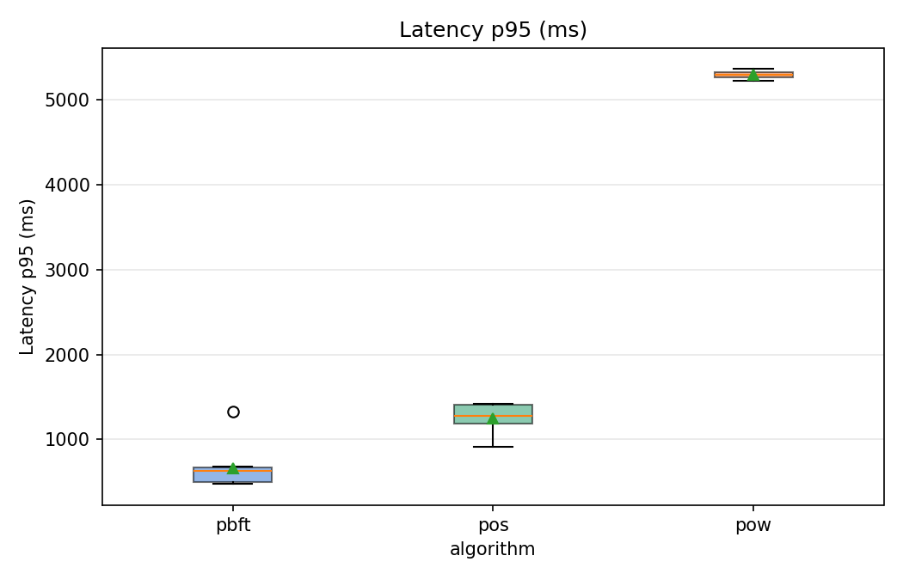

## Finality p95 (ms)

### Descriptives
| Algorithm | n | mean | stdev | median | min | max |
|---|---|---|---|---|---|---|
| pbft | 10 | 693.392 | 301.137 | 657.061 | 473.995 | 1497.809 |
| pos | 9 | 1403.862 | 168.505 | 1429.162 | 1062.166 | 1570.833 |
| pow | 2 | 6623.789 | 39.523 | 6623.789 | 6595.842 | 6651.736 |

### Normality (Shapiro-Wilk)
| Algorithm | Shapiro W | p-value | normal at α |
|---|---|---|---|
| pbft | 0.680 | 0.00050151 | no |
| pos | 0.888 | 0.190946 | yes |
| pow | — | — | (n<3) |

**Test:** Kruskal-Wallis → statistic = 13.522, p = 0.00115803  →  algorithms **differ** at α = 0.05

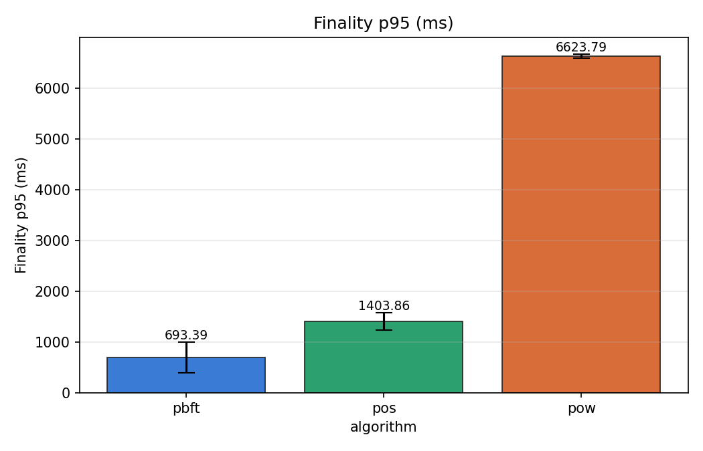
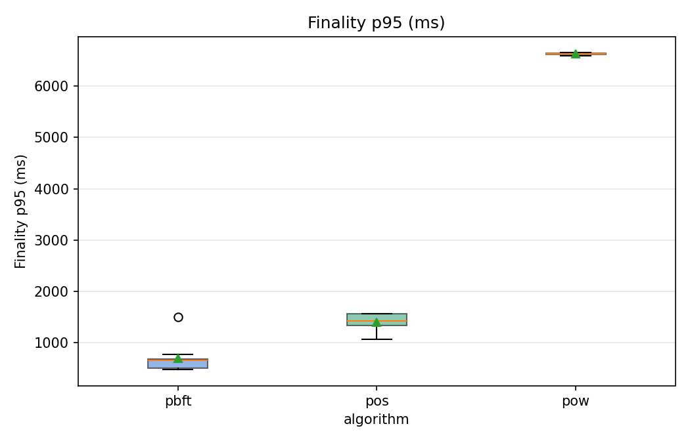

## Energy (J)

### Descriptives
| Algorithm | n | mean | stdev | median | min | max |
|---|---|---|---|---|---|---|
| pbft | 10 | 9.129 | 0.969 | 9.168 | 7.564 | 11.176 |
| pos | 9 | 3.701 | 0.254 | 3.633 | 3.321 | 4.083 |
| pow | 2 | 63.809 | 0.299 | 63.809 | 63.598 | 64.020 |

### Normality (Shapiro-Wilk)
| Algorithm | Shapiro W | p-value | normal at α |
|---|---|---|---|
| pbft | 0.947 | 0.632796 | yes |
| pos | 0.958 | 0.782282 | yes |
| pow | — | — | (n<3) |

**Test:** Kruskal-Wallis → statistic = 16.286, p = 0.000290805  →  algorithms **differ** at α = 0.05

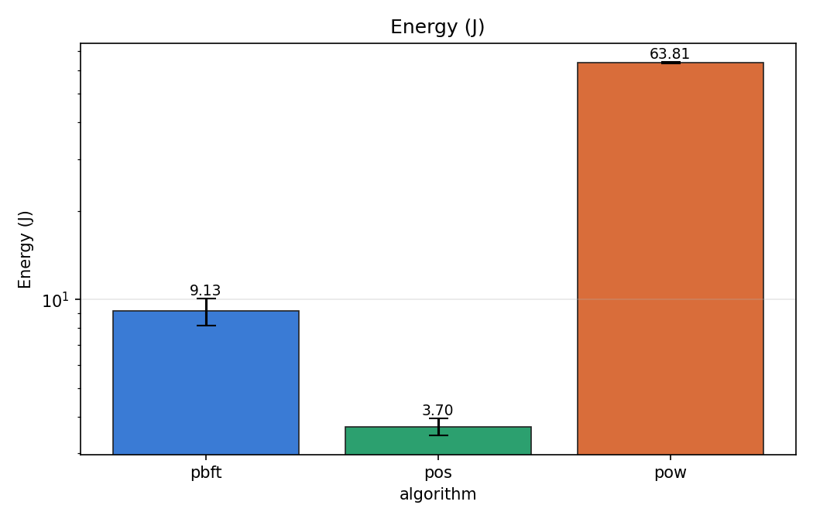
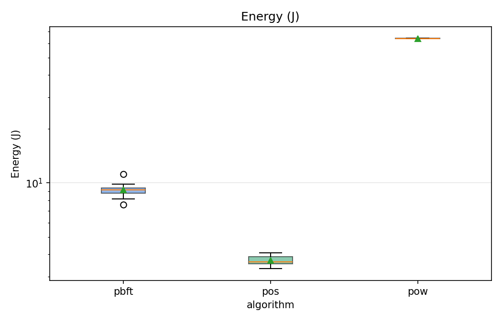

## Bytes per Tx

### Descriptives
| Algorithm | n | mean | stdev | median | min | max |
|---|---|---|---|---|---|---|
| pbft | 10 | 43519.405 | 579.667 | 43430.509 | 42669.990 | 44284.656 |
| pos | 9 | 16704.259 | 80.064 | 16719.200 | 16589.270 | 16819.550 |
| pow | 2 | 339417.750 | 351367.370 | 339417.750 | 90963.500 | 587872.000 |

### Normality (Shapiro-Wilk)
| Algorithm | Shapiro W | p-value | normal at α |
|---|---|---|---|
| pbft | 0.916 | 0.324432 | yes |
| pos | 0.944 | 0.621645 | yes |
| pow | — | — | (n<3) |

**Test:** Kruskal-Wallis → statistic = 16.286, p = 0.000290805  →  algorithms **differ** at α = 0.05

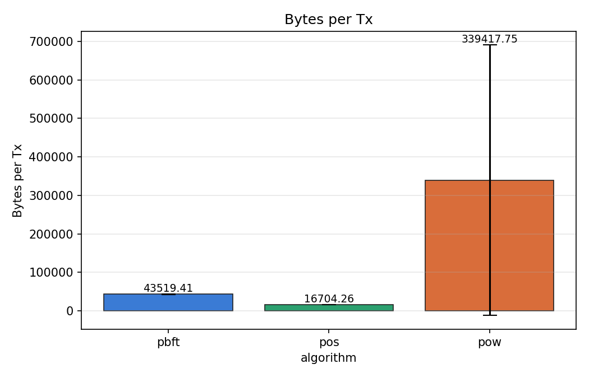
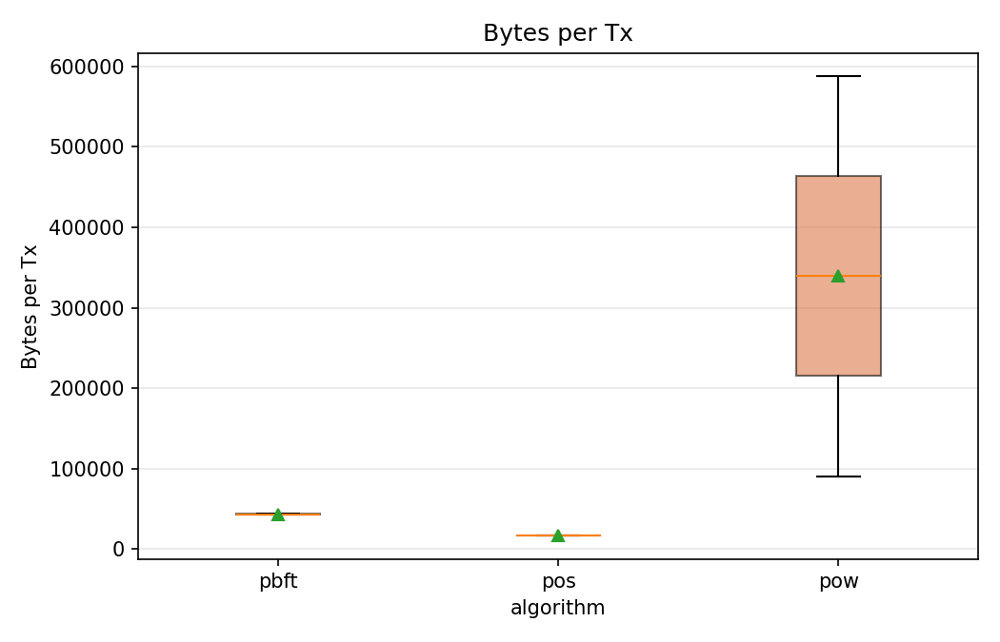

## Threats to Validity

- **Energy proxy.** The reported joules use the model
  `E = (cpu_percent_total / 100) / num_cpus * tdp_watts * duration_s`. Real CPU
  power is non-linear in utilisation (DVFS, idle draw, turbo), so absolute
  numbers are indicative; the *relative* ranking between algorithms is
  what carries weight. See `monitoring/energy_estimator.py` for caveats.
- **PoW reference implementation.** SHA-256 nonce-search at configurable
  difficulty and longest-chain fork handling with a local confirmed-prefix lock.
  This simplified lock differs from probabilistic Nakamoto finality; partitions
  and conflicting confirmed prefixes are not resolved by this prototype. Captures the
  always-on CPU cost of PoW, which is the dimension we measure.
- **PBFT simplifications.** No view changes, no checkpoints, no batching.
  Captures the three-phase agreement cost faithfully but does not stress
  recovery paths.
- **PoS simplifications.** No slashing, no nothing-at-stake protection,
  no finality gadget. Captures the single-proposer-per-slot cost.
- **Network emulation.** Pumba on local Docker Desktop applies netem via
  per-target sidecars; effective rules engage ~3 s after the call. The VPS
  Linux tc driver is an unimplemented stub. Paper-mode runs additionally compose
  delay/rate in the Pumba nettools container namespace and save effective qdiscs.
- **Sample size.** Each scenario must have ≥5 repetitions for ANOVA /
  Kruskal-Wallis to be meaningful; entries marked `skipped` indicate
  insufficient data. Statistical significance alone does not establish
  practical importance, pairwise differences, or generality to production chains.

_Edit this section for the IEEE submission with experiment-specific notes._

