# Experiment Report — final_pow_diff14

- **Generated:** 2026-10-15T02:09:23Z
- **Algorithms compared:** pow
- **Repetitions per algorithm:** up to 10
- **Significance threshold (α):** 0.05

## Reliability

Runs where `committed_by_quorum == 0` — i.e. the consensus protocol
made no forward progress and no transaction reached the quorum. These
are **excluded** from the per-metric tables below; they belong to the
reliability metric itself, not to the TPS / latency / energy aggregates.

| Algorithm | Total runs | Failed | Successful | Failure rate |
|---|---|---|---|---|
| pow | 10 | 0 | 10 | 0.0% |

_All runs reached the quorum — no protocol-level failures._

Nonzero progress can be partial; it does not imply all submitted transactions finished.

| Algorithm | Partial | Complete | Committed total | Energy all runs (J) | Pooled J/committed tx |
|---|---:|---:|---:|---:|---:|
| pow | 4 | 6 | 993 | 470.458 | 0.473775 |

Pooled J/tx includes energy from zero-progress runs. Metric tables below condition on >0 progress, including partial runs. Latency samples exclude unconfirmed requests; interpret them with completion counts.

## Summary

| Metric | Test | Statistic | p-value | α=0.05 verdict |
|---|---|---|---|---|
| Throughput (TPS) | skipped | — | — | skipped (need ≥2 algorithm groups, found 1 (['pow'])) |
| Latency p50 (ms) | skipped | — | — | skipped (need ≥2 algorithm groups, found 1 (['pow'])) |
| Latency p95 (ms) | skipped | — | — | skipped (need ≥2 algorithm groups, found 1 (['pow'])) |
| Finality p95 (ms) | skipped | — | — | skipped (need ≥2 algorithm groups, found 1 (['pow'])) |
| Energy (J) | skipped | — | — | skipped (need ≥2 algorithm groups, found 1 (['pow'])) |
| Bytes per Tx | skipped | — | — | skipped (need ≥2 algorithm groups, found 1 (['pow'])) |

## Throughput (TPS)

### Descriptives
| Algorithm | n | mean | stdev | median | min | max |
|---|---|---|---|---|---|---|
| pow | 10 | 23.550 | 4.027 | 25.739 | 16.149 | 27.072 |

### Normality (Shapiro-Wilk)
| Algorithm | Shapiro W | p-value | normal at α |
|---|---|---|---|
| pow | 0.819 | 0.0248038 | no |

**Test:** skipped — need ≥2 algorithm groups, found 1 (['pow'])

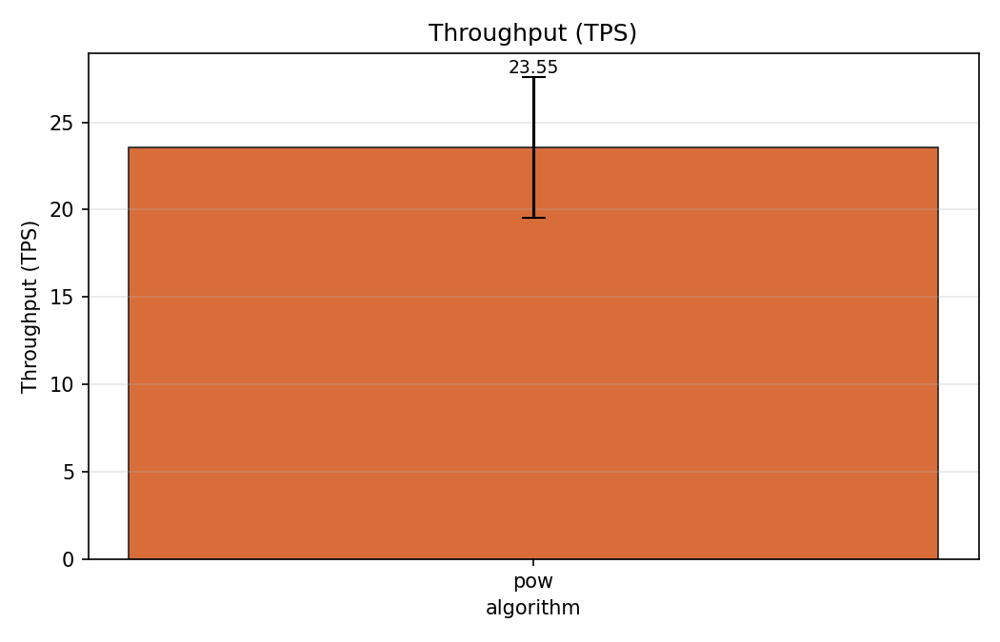
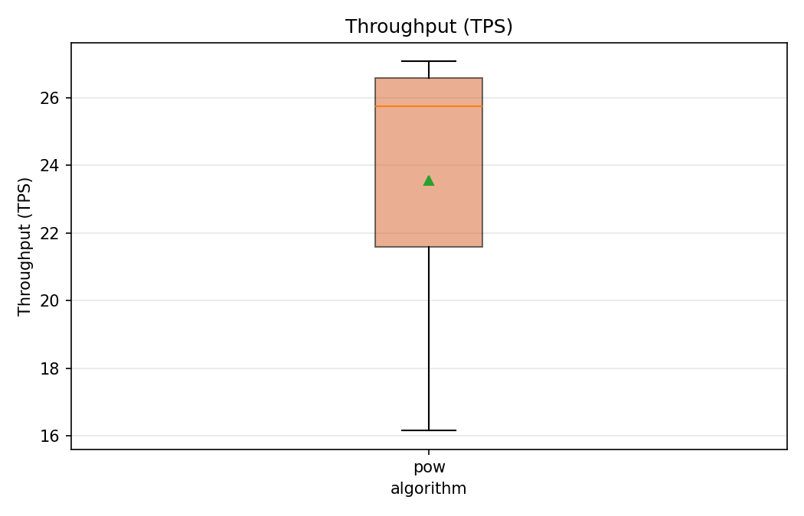

## Latency p50 (ms)

### Descriptives
| Algorithm | n | mean | stdev | median | min | max |
|---|---|---|---|---|---|---|
| pow | 10 | 1641.376 | 683.050 | 1900.924 | 676.365 | 2490.943 |

### Normality (Shapiro-Wilk)
| Algorithm | Shapiro W | p-value | normal at α |
|---|---|---|---|
| pow | 0.881 | 0.133565 | yes |

**Test:** skipped — need ≥2 algorithm groups, found 1 (['pow'])

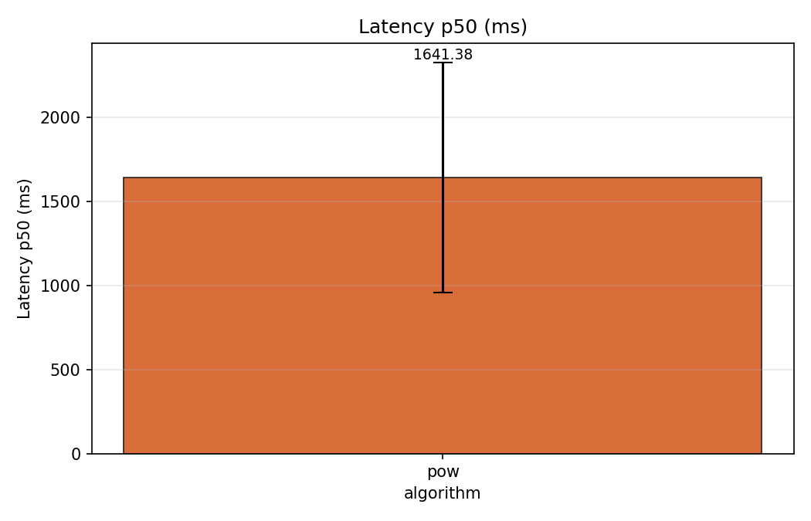
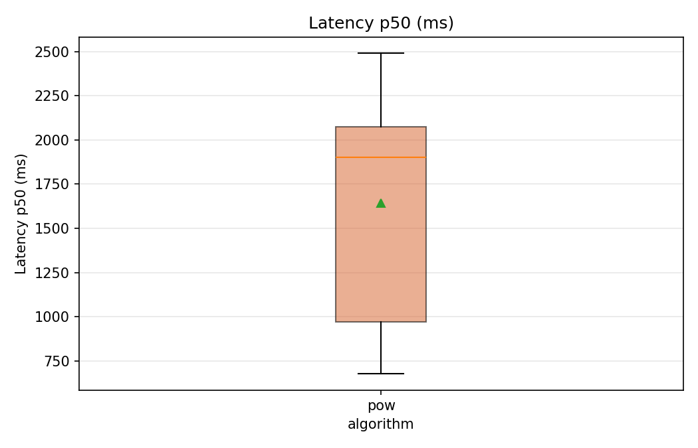

## Latency p95 (ms)

### Descriptives
| Algorithm | n | mean | stdev | median | min | max |
|---|---|---|---|---|---|---|
| pow | 10 | 2208.302 | 631.721 | 2236.346 | 1361.231 | 3170.546 |

### Normality (Shapiro-Wilk)
| Algorithm | Shapiro W | p-value | normal at α |
|---|---|---|---|
| pow | 0.943 | 0.58389 | yes |

**Test:** skipped — need ≥2 algorithm groups, found 1 (['pow'])

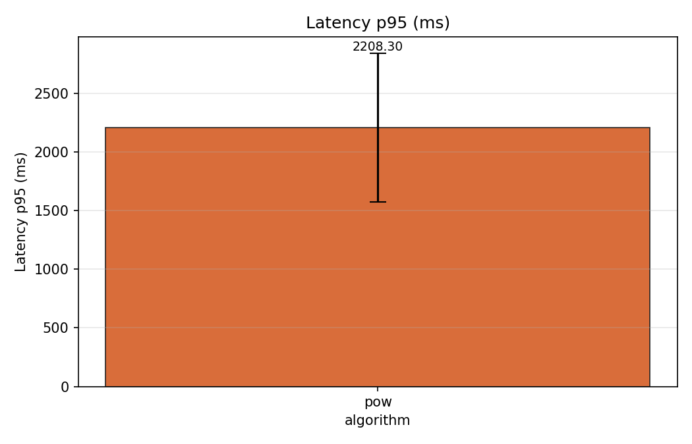
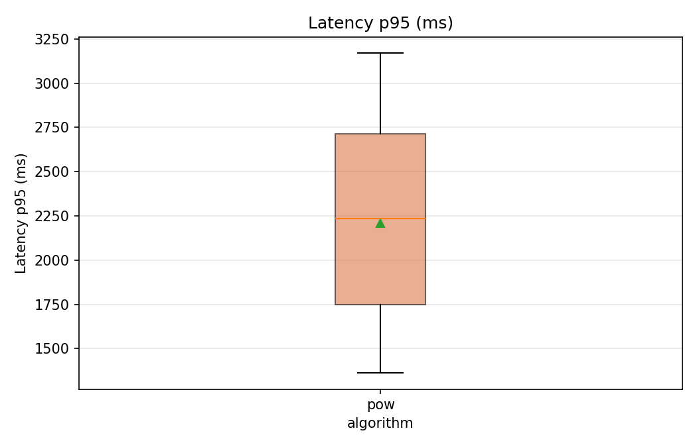

## Finality p95 (ms)

### Descriptives
| Algorithm | n | mean | stdev | median | min | max |
|---|---|---|---|---|---|---|
| pow | 10 | 2208.302 | 631.721 | 2236.346 | 1361.231 | 3170.546 |

### Normality (Shapiro-Wilk)
| Algorithm | Shapiro W | p-value | normal at α |
|---|---|---|---|
| pow | 0.943 | 0.58389 | yes |

**Test:** skipped — need ≥2 algorithm groups, found 1 (['pow'])

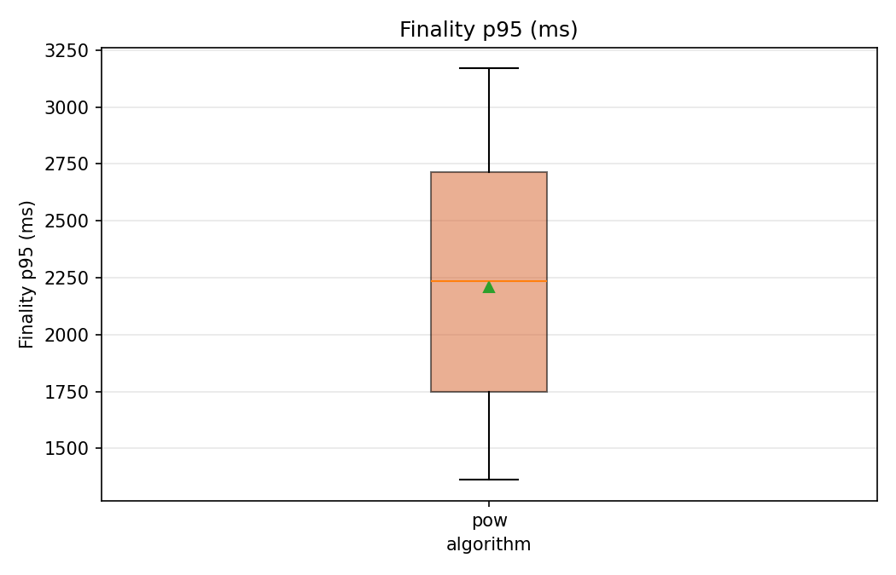

## Energy (J)

### Descriptives
| Algorithm | n | mean | stdev | median | min | max |
|---|---|---|---|---|---|---|
| pow | 10 | 47.046 | 1.459 | 47.437 | 45.326 | 49.984 |

### Normality (Shapiro-Wilk)
| Algorithm | Shapiro W | p-value | normal at α |
|---|---|---|---|
| pow | 0.879 | 0.128585 | yes |

**Test:** skipped — need ≥2 algorithm groups, found 1 (['pow'])

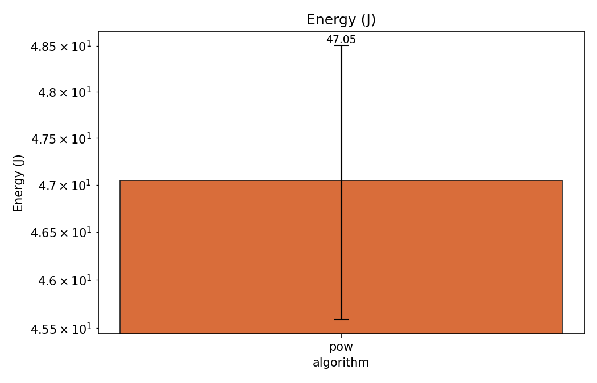
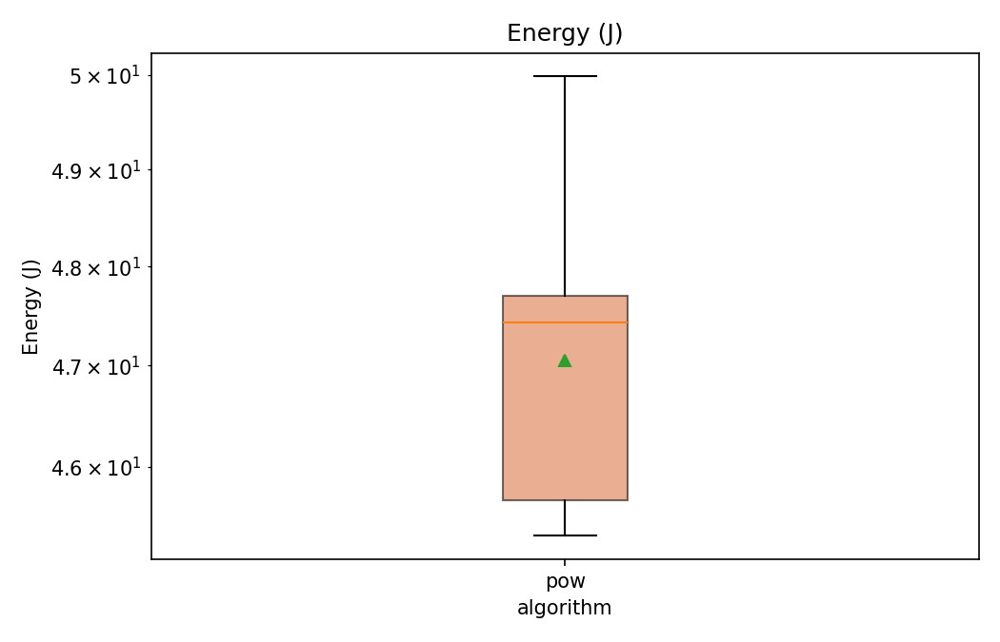

## Bytes per Tx

### Descriptives
| Algorithm | n | mean | stdev | median | min | max |
|---|---|---|---|---|---|---|
| pow | 10 | 13591.669 | 705.655 | 13557.458 | 12780.265 | 15097.940 |

### Normality (Shapiro-Wilk)
| Algorithm | Shapiro W | p-value | normal at α |
|---|---|---|---|
| pow | 0.918 | 0.342393 | yes |

**Test:** skipped — need ≥2 algorithm groups, found 1 (['pow'])

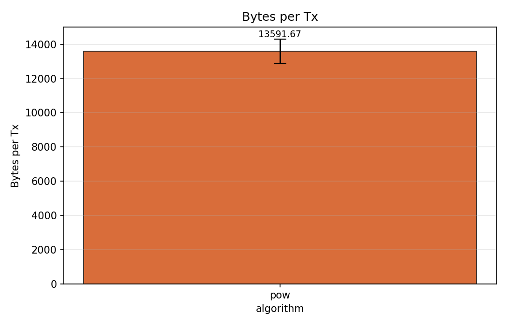
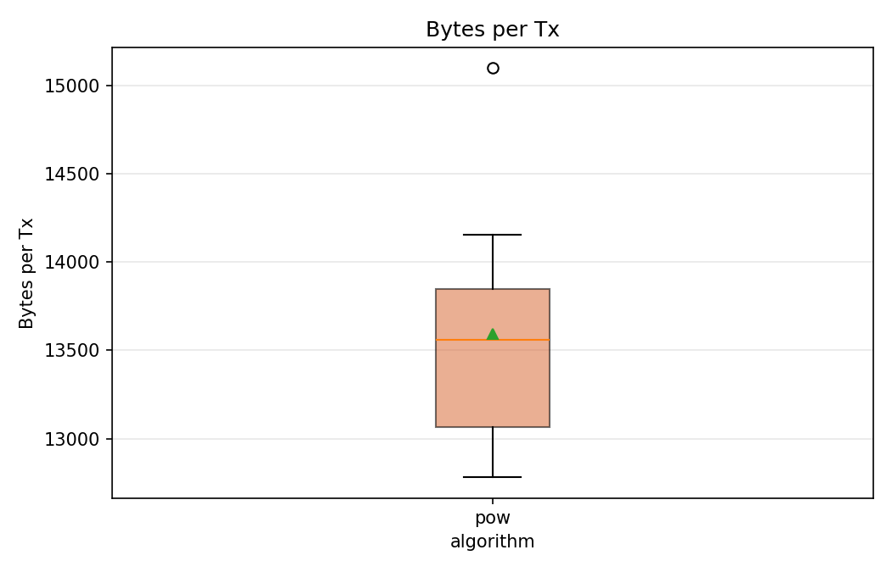

## Threats to Validity

- **Energy proxy.** The reported joules use the model
  `E = (cpu_percent_total / 100) / num_cpus * tdp_watts * duration_s`. Real CPU
  power is non-linear in utilisation (DVFS, idle draw, turbo), so absolute
  numbers are indicative; the *relative* ranking between algorithms is
  what carries weight. See `monitoring/energy_estimator.py` for caveats.
- **PoW reference implementation.** SHA-256 nonce-search at configurable
  difficulty and longest-chain fork handling with a local confirmed-prefix lock.
  This simplified lock differs from probabilistic Nakamoto finality; partitions
  and conflicting confirmed prefixes are not resolved by this prototype. Captures the
  always-on CPU cost of PoW, which is the dimension we measure.
- **PBFT simplifications.** No view changes, no checkpoints, no batching.
  Captures the three-phase agreement cost faithfully but does not stress
  recovery paths.
- **PoS simplifications.** No slashing, no nothing-at-stake protection,
  no finality gadget. Captures the single-proposer-per-slot cost.
- **Network emulation.** Pumba on local Docker Desktop applies netem via
  per-target sidecars; effective rules engage ~3 s after the call. The VPS
  Linux tc driver is an unimplemented stub. Paper-mode runs additionally compose
  delay/rate in the Pumba nettools container namespace and save effective qdiscs.
- **Sample size.** Each scenario must have ≥5 repetitions for ANOVA /
  Kruskal-Wallis to be meaningful; entries marked `skipped` indicate
  insufficient data. Statistical significance alone does not establish
  practical importance, pairwise differences, or generality to production chains.

_Edit this section for the IEEE submission with experiment-specific notes._

