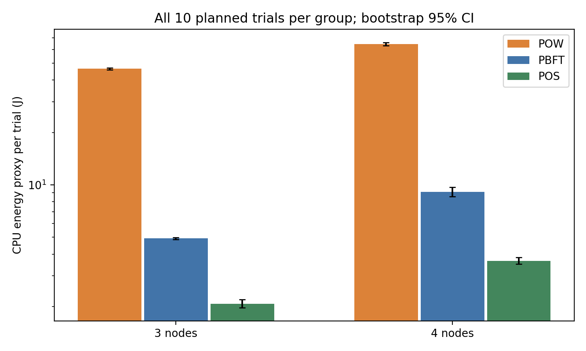
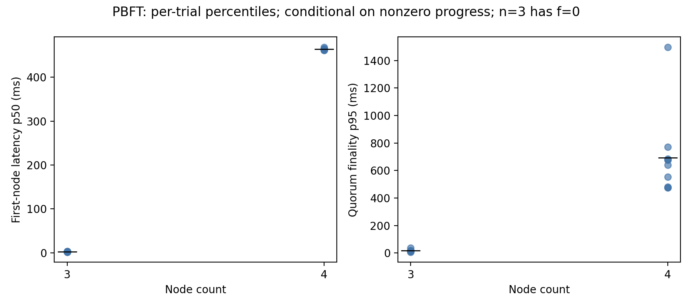
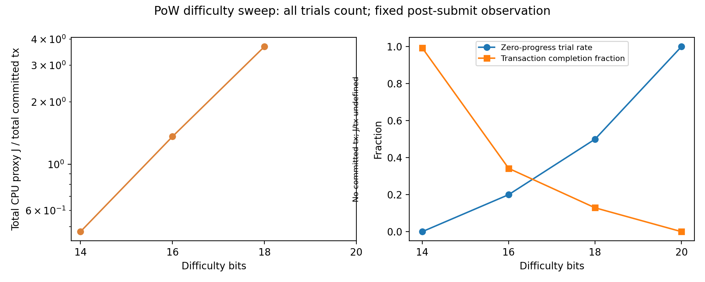

# Resultados finales de los experimentos

**Campana completa: 90/90 corridas planificadas, diez por grupo, sin reemplazar fallos.** Esta entrega consolida resultados; no es el paper.

## Protocolo y alcance

- Tres implementaciones Python concretas: PoW SHA-256, PoS por slots y PBFT simplificado. Comparacion n=3/n=4; barrido PoW 14/16/18/20 bits en n=3. La dificultad 16 reutiliza el grupo PoW del baseline n=3; no se cuenta dos veces en la base.
- Carga: 100 tx a 50 TPS solicitadas; bloques de 20 tx en PoW/PoS; confirmations=1; slots PoS=0.5 s; 2 CPU y 2 GiB por nodo. No es una medicion de capacidad maxima ni una prueba de ataques bizantinos.
- Red: 50 ms de retraso de salida, jitter=0 y limite de 10 Mbps simultaneos; reglas efectivas verificadas y guardadas por nodo. Pumba administra el qdisc; su imagen nettools permite componer y verificar una unica regla en el namespace del contenedor.
- Horizonte: duracion del envio mas 5 s; eventos posteriores al corte registrado quedan censurados. No se espera 600 s a que terminen las transacciones. Ese parametro fija la vida de las reglas de red.
- Energia primaria: promedio de uso de CPU por contenedor * duracion de sus muestras * 45 W / CPU logicas del host. Incluye el intervalo de preparacion del muestreo, anterior al envio. Es un proxy CPU; no energia fisica total ni calibrada con wattimetro. Se conservan todas las muestras y sus duraciones reales.
- Se fijaron imagenes por identificador/digest, snapshots por UUID, copia del codigo con SHA-256, versiones de dependencias, hardware y orden aleatorizado por bloques con seed=20261014. Las claves de prueba derivan del seed; los tiempos y el scheduling siguen siendo no deterministas.
- Servicios ajenos ya activos se registraron en manifest.json y no se detuvieron. Se registro CPU del host antes de cada corrida; no se garantiza aislamiento fisico ni ausencia total de carga externa.

## Resultados principales

Cero = ninguna tx confirmada por quorum; parcial = alguna pero no todas; completa = todas. Energia y TPS de observacion incluyen TODAS las corridas. J/tx global incluye tambien energia de los fallos y usa las confirmaciones realmente observadas.

| Conjunto | Algoritmo | N | Cero/parcial/completa | Tx confirmadas/1000 | Energia J media +/- SD | TPS observacion media | J/tx global |
|---|---|---:|---|---:|---:|---:|---:|
| final_n3_baseline | pbft | 10 | 0/0/10 | 1000 | 4.922 +/- 0.116 | 14.086 | 0.049221 |
| final_n3_baseline | pos | 10 | 1/0/9 | 900 | 2.076 +/- 0.182 | 12.712 | 0.023065 |
| final_n3_baseline | pow | 10 | 2/7/1 | 342 | 46.484 +/- 1.179 | 4.828 | 1.359195 |
| final_n4_baseline | pbft | 10 | 0/10/0 | 928 | 9.129 +/- 0.969 | 13.070 | 0.098369 |
| final_n4_baseline | pos | 10 | 1/0/9 | 900 | 3.658 +/- 0.275 | 12.707 | 0.040648 |
| final_n4_baseline | pow | 10 | 8/2/0 | 23 | 64.354 +/- 2.322 | 0.324 | 27.979836 |
| final_pow_diff14 | pow | 10 | 0/4/6 | 993 | 47.046 +/- 1.459 | 14.017 | 0.473775 |
| final_pow_diff18 | pow | 10 | 5/5/0 | 129 | 47.536 +/- 0.709 | 1.821 | 3.684966 |
| final_pow_diff20 | pow | 10 | 10/0/0 | 0 | 46.429 +/- 1.014 | 0.000 | NA |

summary.csv/summary.json incluyen intervalos bootstrap 95% (10000 remuestreos de corridas), medianas, rangos y poblaciones. Los intervalos de tasa de fallo usan Wilson. Para J/tx se remuestrean pares energia/confirmaciones por corrida: si aparecen denominadores cero se registra su fraccion; un limite superior no acotado se marca explicitamente y se guarda como null en JSON. No se ocultan esos remuestreos. Los intervalos cuantifican variacion entre corridas; no incluyen incertidumbre ni error sistematico del modelo energetico.

## Contrastes estadisticos

Analisis primario robusto: Kruskal-Wallis sobre todas las corridas para energia, TPS de observacion y fraccion completada; Holm sobre los seis contrastes n=3/n=4. Comparaciones por pares: Mann-Whitney bilateral con correccion de empates, Holm sobre los 18 pares y delta de Cliff. El barrido usa tres contrastes globales adicionales con su propia correccion Holm. Las familias se separan por pregunta de investigacion y quedan explicitas. Los p-values no se redondean a cero.

| Escenario | Metrica | H | p crudo | p Holm | Diferencia a 0.05 |
|---|---|---:|---:|---:|---|
| final_n3_baseline | energy_joules | 25.806 | 2.49001e-06 | 1.494e-05 | si |
| final_n3_baseline | throughput_observation_tps | 12.354 | 0.00207642 | 0.00207642 | si |
| final_n3_baseline | completion_fraction | 18.607 | 9.10963e-05 | 0.000182193 | si |
| final_n4_baseline | energy_joules | 25.806 | 2.49001e-06 | 1.494e-05 | si |
| final_n4_baseline | throughput_observation_tps | 21.201 | 2.49058e-05 | 7.47173e-05 | si |
| final_n4_baseline | completion_fraction | 21.84 | 1.80946e-05 | 7.23784e-05 | si |

Los tests globales no prueban por si solos cada diferencia por pares. secondary_statistical_diagnostics.json identifica grupos con n insuficiente o varianzas incompatibles con ANOVA; esos contrastes secundarios no deben citarse como inferencia. Los contrastes son exploratorios de estos prototipos/host; no establecen causalidad ni equivalencia de seguridad. El pipeline tradicional del proyecto (Shapiro -> ANOVA/Kruskal) tambien se genero bajo ../analysis/, condicionado a progreso >0, como analisis secundario. No mezclar sus poblaciones con las primarias. conditional_sample_eligibility.json marca grupos con menos de cinco observaciones condicionales: sus latencias son solo descriptivas, y ningun contraste secundario de esos grupos debe citarse como inferencia del paper.

## Figuras exportables

Cada figura tambien esta disponible en SVG. El eje de energia es logaritmico. Los valores de latencia son medias/distribuciones de percentiles por corrida; no percentiles agrupados de todas las transacciones. Latencia usa el primer nodo y puede incluir tx que no alcanzaron quorum; finalidad usa solo las que alcanzaron quorum. Las peticiones sin esas confirmaciones no entran en esos percentiles.

## Cierre de pendientes y limites

- La campana incompleta n4_baseline_v2 queda archivada y sustituida para la entrega final por final_n4_baseline, con 10 corridas por algoritmo en una misma version. No se completaron los huecos mezclando ejecuciones separadas por meses.
- Se distingue confirmacion parcial de completa; fallo total y completitud se reportan junto a latencia. No se borraron ni reemplazaron fallos. Un lote completo no implica que el protocolo completo todas las transacciones.
- Se corrigieron los denominadores historicos del barrido: diff14=1000, diff16=794, diff18=207, diff20=3 tx confirmadas; J/tx global historico=0.566293, 0.693428, 2.705970 y 184.082256. Estas cifras pertenecen a la campana anterior, no a la tabla nueva.
- La inspeccion encontro que sidecars Pumba independientes pueden sobrescribir la regla raiz; en una reproduccion con la configuracion antigua quedaron delay=50 ms y jitter=10 ms sin rate. No se puede probar retrospectivamente la regla de cada corrida historica porque no se guardaba. Por ello no se atribuye a 10 Mbps verificados la evidencia antigua.
- La comparacion antes/despues de PoW es contextual: cambiaron fecha, entorno y aplicacion de red. No permite atribuir causalmente diferencias al arreglo de forks. El codigo conserva una proteccion local del prefijo confirmado; no implementa toda la finalidad probabilistica de Nakamoto ni recuperacion de particiones.
- PBFT n=3 tiene f=0 y quorum=1: su latencia no prueba tolerancia bizantina bajo red. El runner aplica quorum=2*floor((n-1)/3)+1 a todos los algoritmos; para n=4 es 3. Es una convencion de observacion, no equivalencia de seguridad entre protocolos.
- PBFT no implementa cambios de vista/checkpoints/batching; PoS no implementa slashing/finality gadget ni recuperacion robusta de bloques perdidos. Los fallos observados no deben generalizarse a todo PoS/PoW/PBFT.
- n=5/n=7, saturacion, ataques bizantinos, calibracion fisica y VPS no forman parte de la campana realizada; se delimitan como trabajo futuro, sin presentarlos como resultados existentes.

## Evidencia y reproducibilidad

- Integridad SQLite: ok; discrepancias de auditoria: 0; datos historicos intactos: True.
- runs.csv: valores por UUID, parametros y poblacion; container_resources.csv: CPU/memoria/red por contenedor.
- summary.csv/json: agregados, incertidumbre y denominadores. primary_statistics.*, pairwise_statistics.* y difficulty_statistics.json: pruebas completas.
- validation.json y evidence_sha256.csv: verificaciones y hashes de todos los archivos de corrida.
- ../manifest.json, ../source/, ../configs/, ../requirements-audit.lock.txt: protocolo, imagenes, codigo y versiones congeladas. ../progress.jsonl y ../status.json: progreso de la ejecucion.
- ../<UUID>/: config.json, metrics.json, raw_events.csv, resource_samples.json y logs de cada nodo. ../historical_snapshot.sqlite conserva el estado previo a la campana.

Para regenerar esta entrega desde el proyecto: `.venv/Scripts/python.exe analysis/final_results.py`. Para consultar la campana en CLI: `.venv/Scripts/python.exe run_experiment.py --db results/final_campaign_20261014/experiments.db list`.

## CPU, memoria, red y duraciones

summary.csv/json incluyen media/SD/mediana/rango/IC95 de CPU, memoria, RX/TX, duracion de observacion y muestras, ademas de p50/p95/p99/media de latencia y finalidad. Los recursos incluyen TODAS las corridas. CPU 100% equivale a un nucleo; la suma de promedios por nodo puede superar 100%. Memoria agregada es suma de promedios por nodo, no un pico simultaneo. Los picos exportados son maximos por nodo, sin afirmar simultaneidad. network_pooled_bytes_per_committed_tx usa trafico de todas las corridas / confirmaciones reales. RX+TX cuenta ambos sentidos y puede contabilizar el mismo paquete en dos extremos.

| Conjunto | Algoritmo | CPU suma medias % | Memoria suma medias MiB | RX medio bytes | TX medio bytes | Observacion media s |
|---|---|---:|---:|---:|---:|---:|
| final_n3_baseline | pbft | 29.025 | 39.414 | 1086598 | 1066783 | 7.099 |
| final_n3_baseline | pos | 12.220 | 39.686 | 435237 | 426505 | 7.081 |
| final_n3_baseline | pow | 274.127 | 60.002 | 470582 | 460109 | 7.083 |
| final_n4_baseline | pbft | 53.700 | 54.657 | 2029212 | 2008558 | 7.100 |
| final_n4_baseline | pos | 21.646 | 54.335 | 832966 | 823911 | 7.086 |
| final_n4_baseline | pow | 372.255 | 83.251 | 920339 | 908223 | 7.085 |
| final_pow_diff14 | pow | 276.303 | 61.550 | 680145 | 669674 | 7.084 |
| final_pow_diff18 | pow | 274.761 | 59.397 | 428262 | 417774 | 7.084 |
| final_pow_diff20 | pow | 273.914 | 58.912 | 412303 | 402164 | 7.083 |

CPU del host muestreada antes de cada intento: minimo 17.5%, mediana 30.9%, maximo 61.4%. Son muestras breves de 0.2 s; no certifican aislamiento ni carga sostenida y no se usaron para excluir corridas.

El modelo de CPU esta en ../hardware_cpu.json y la asignacion de Docker/WSL2 en ../manifest.json. Las duraciones de los recursos corresponden a las primeras/ultimas muestras por nodo y pueden diferir de la ventana de eventos.

## Comparacion contextual con los lotes anteriores

La tabla conserva todos los intentos de cada lote. Hay diferencias de fecha, entorno y aplicacion de red; no es un experimento controlado que aisle el efecto del arreglo de PoW.

| Lote n=4 | Algoritmo | N | Cero/parcial/completa | Tx confirmadas | Energia media todos J | J/tx global |
|---|---|---:|---|---:|---:|---:|
| n4_baseline | pow | 10 | 1/9/0 | 149 | 77.585 | 5.207079 |
| n4_baseline | pbft | 10 | 0/8/2 | 979 | 15.212 | 0.155380 |
| n4_baseline | pos | 10 | 2/0/8 | 800 | 5.446 | 0.068078 |
| n4_baseline_v2 | pow | 10 | 4/6/0 | 154 | 81.558 | 5.295982 |
| n4_baseline_v2 | pbft | 8 | 0/8/0 | 778 | 15.380 | 0.158147 |
| n4_baseline_v2 | pos | 0 | 0/0/0 | 0 | NA | NA |
| final_n4_baseline | pow | 10 | 8/2/0 | 23 | 64.354 | 27.979836 |
| final_n4_baseline | pbft | 10 | 0/10/0 | 928 | 9.129 | 0.098369 |
| final_n4_baseline | pos | 10 | 1/0/9 | 900 | 3.658 | 0.040648 |

historical_comparison.csv incluye tambien n=3. N=0 significa datos ausentes, no cero fallos. La campana final se considera completa por cobertura de sus 90 escenarios, con sus fallos y limitaciones visibles.
